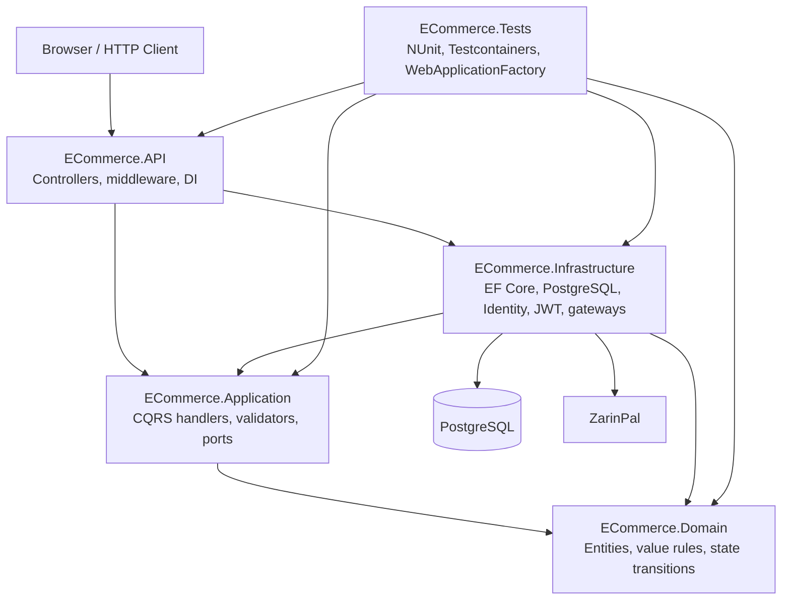
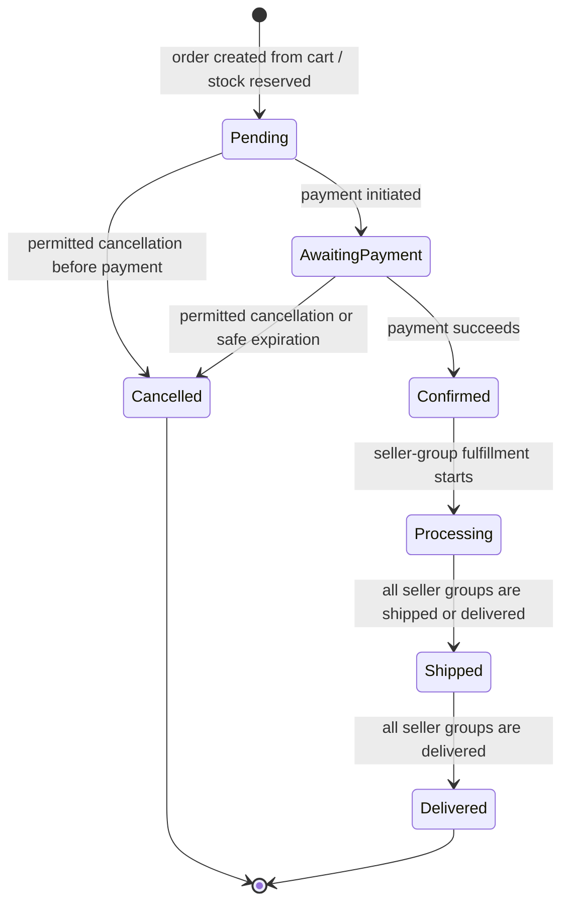
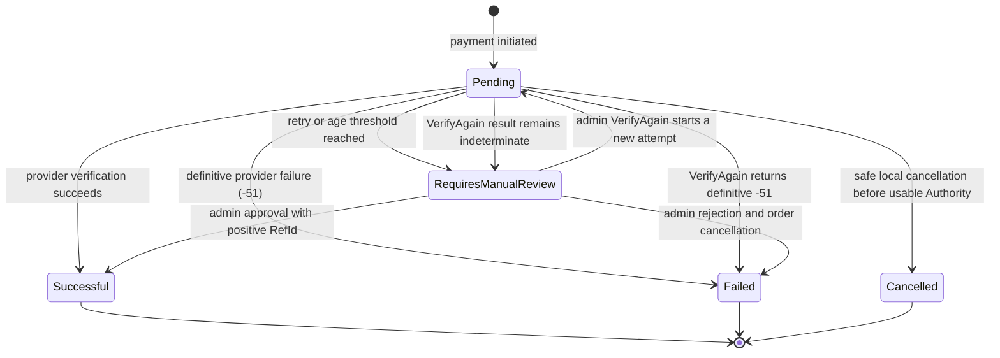

# ECommerce — Multi-Vendor Marketplace Backend

A multi-vendor marketplace backend built with **.NET 10**, **ASP.NET Core**, and **PostgreSQL**. The project is designed as a portfolio-quality backend: it demonstrates the core customer purchase journey, seller-specific order fulfillment, payment verification and reconciliation, and role-protected administration APIs.

> **Project status:** MVP backend in active development. The repository contains the API and its automated tests; a production frontend is not included.

## What this project demonstrates

- Clean Architecture with separate Domain, Application, Infrastructure, and API projects.
- CQRS request handling with MediatR and FluentValidation.
- ASP.NET Core Identity, JWT access tokens, and refresh-token rotation.
- Multi-vendor checkout with seller-specific `OrderGroup` records.
- Inventory reservation during order creation and stock restoration on permitted cancellation paths.
- Optimistic concurrency for sensitive state transitions.
- ZarinPal payment initiation, callback verification, background reconciliation, and administrative manual resolution.
- PostgreSQL persistence with EF Core migrations.
- Password-reset email delivery through MailKit SMTP, with Mailpit capture in the local Docker Compose stack.
- NUnit tests, including PostgreSQL integration tests with Testcontainers and API end-to-end tests with `WebApplicationFactory`.
- Development-only marketplace seed data for a quick local demonstration.
- An isolated public Demo environment with deterministic mock payments, configuration-provisioned seed accounts, TLS SMTP, and a dedicated Docker Compose deployment profile.

## Technology stack

| Area | Technologies |
|---|---|
| Runtime and API | .NET 10, ASP.NET Core Web API |
| Architecture | Clean Architecture, CQRS, MediatR |
| Validation | FluentValidation |
| Persistence | PostgreSQL, Entity Framework Core |
| Identity and security | ASP.NET Core Identity, JWT, HttpOnly refresh-token cookie, token rotation and replay detection |
| Payments | ZarinPal integration, payment verification and reconciliation, Development-only mock endpoints, isolated authenticated Demo payment endpoints |
| Email | MailKit SMTP, Mailpit for local email capture |
| Logging and health | Serilog, `/health/live`, `/health/ready` |
| API exploration | OpenAPI, Scalar (Development; opt-in in the isolated Demo environment) |
| Testing | NUnit, Testcontainers, `WebApplicationFactory` |
| Local environment | Docker, Docker Compose |

## Solution architecture

The solution is split by responsibility. The Domain project does not depend on outer layers; Application contains use cases and ports; Infrastructure implements persistence and external integrations; API is the HTTP composition and delivery layer.



### Projects

| Project | Responsibility |
|---|---|
| `ECommerce.Domain` | Domain entities, enums, invariants, and business state transitions. |
| `ECommerce.Application` | CQRS commands/queries, handlers, validators, response contracts, and abstractions. |
| `ECommerce.Infrastructure` | EF Core mappings and repositories, PostgreSQL, Identity/JWT, payment and email integrations, background services. |
| `ECommerce.API` | HTTP controllers, authentication/authorization configuration, middleware, dependency injection, health checks, and API documentation. |
| `ECommerce.Tests` | Domain and application tests, PostgreSQL integration tests, and API end-to-end tests. |

## Quick start — Docker Compose

The quickest way to run the API and PostgreSQL locally is Docker Compose.

### Prerequisites

- Docker Desktop (or Docker Engine with the Compose plugin).
- Internet access to pull the .NET, PostgreSQL, and Mailpit images.

### 1. Create your local environment file

PowerShell:

```powershell
Copy-Item .env.example .env
```

Bash:

```bash
cp .env.example .env
```

The template values are intended for local development only. Do not reuse them in shared, staging, or production environments. Keep `.env` out of source control.

### 2. Start the application

```bash
docker compose up --build -d
docker compose logs -f api
```

The API waits for PostgreSQL to become healthy. In the `Development` environment, startup applies EF Core migrations and then seeds development roles, accounts, and marketplace catalog data. Docker Compose also routes password-reset email to Mailpit; no email leaves your machine.

### 3. Open the API

- Scalar: <http://localhost:8080/scalar/v1>
- OpenAPI JSON: <http://localhost:8080/openapi/v1.json>
- Liveness: <http://localhost:8080/health/live>
- Readiness: <http://localhost:8080/health/ready>
- Mailpit inbox: <http://localhost:8025>

Scalar and the generated OpenAPI document are exposed in Development. They can also be explicitly enabled in the isolated Demo environment with `DemoApiDocumentation__Enabled=true`; the setting is rejected in every other environment. Keep `ASPNETCORE_ENVIRONMENT=Demo` for a public demo rather than deploying Development.

### 4. Stop the application

Stop containers and preserve the database volume:

```bash
docker compose down
```

To remove the local database volume as well (this permanently deletes the local database data):

```bash
docker compose down --volumes
```

The API, PostgreSQL, and Mailpit ports bind to loopback by default. The supplied `.env.example` publishes PostgreSQL on host port `15432` (`POSTGRES_PORT=15432`), Mailpit SMTP on `1025`, and its web inbox on `8025`; the containers use their internal service ports. Change the corresponding environment variables if a port is already in use. The API container connects to PostgreSQL at `postgres:5432` and Mailpit at `mailpit:1025` over the Compose network.

### Run the isolated Demo stack

The public Demo profile is separate from Development: it uses its own PostgreSQL database and volumes, deterministic authenticated payment endpoints, configuration-backed seed credentials, and TLS SMTP. It never enables the Development environment or the randomized Development mock routes.

```powershell
Copy-Item .env.demo.example .env.demo
# Edit .env.demo and replace every placeholder before continuing.
docker compose --env-file .env.demo -f docker-compose.demo.yml config --quiet
docker compose --env-file .env.demo -f docker-compose.demo.yml up --build -d
```

The API is available locally at `http://127.0.0.1:8081` and binds to loopback by default. A public deployment must put a TLS-terminating reverse proxy in front of it. See [Public Demo environment](docs/public-demo.md) for the required secrets, SMTP, forwarded-header trust, health checks, persistent volumes, and shutdown/reset behavior. Do not commit `.env.demo` or deploy with the example credentials.

## Run the API from the host

Use this option when you have the .NET 10 SDK installed and want to run the API outside Docker while PostgreSQL remains containerized.

```bash
docker compose up -d postgres
```

Configure local user secrets (PowerShell or Bash):

```bash
dotnet user-secrets set "ConnectionStrings:ECommerceDb" "Host=localhost;Port=15432;Database=ecommerce;Username=postgres;Password=local-dev-password" --project ECommerce.API
dotnet user-secrets set "Jwt:SecretKey" "development-only-change-this-to-a-random-secret-with-at-least-32-bytes" --project ECommerce.API
```

Then run:

```bash
dotnet run --project ECommerce.API --launch-profile http
```

The API uses the URLs configured in `ECommerce.API/Properties/launchSettings.json`; the `http` profile listens on `http://localhost:5115`. Open `/scalar/v1` on that address. If you use the `https` profile instead, use `https://localhost:7102`. When running the API directly on the host, the existing Development email sender logs reset links; Mailpit SMTP is enabled only by the Docker Compose configuration.

## Development demo accounts and catalog

The Development seeder creates local-only accounts with the following roles:

| Role | Email | Password |
|---|---|---|
| Admin | `admin@test.com` | `Password123!` |
| Seller | `seller@test.com` | `Password123!` |
| Seller | `seller2@test.com` | `Password123!` |
| Customer | `customer@test.com` | `Password123!` |

These credentials must never be used outside a local Development environment.

The demo catalog includes multiple brands, a hierarchical category tree, products, variants, HTTPS product images, and seller offers from two active sellers. Catalog seeding is designed to be idempotent: restarting the Development API should not create duplicate demo catalog records. See [Development seed](docs/development-seed.md).

### Test password-reset email locally

When using Docker Compose, send `POST /api/auth/forgot-password` with `{"email":"customer@test.com"}` and open <http://localhost:8025> to inspect the captured message. Mailpit is bound to loopback and does not deliver messages to real recipients. The reset link uses `PasswordResetEmail:FrontendUrl`; the local API configuration points to the Development frontend route.

When running the API directly on the host without SMTP settings, the Development-only email sender writes the reset link to the application log instead. Never enable that Development behavior on a public deployment.

## Five-minute API demo

The repository includes an HTTP request collection at [`ECommerce.API/ECommerce.API.http`](ECommerce.API/ECommerce.API.http). Run it with the REST Client extension in Visual Studio Code or another editor that supports `.http` files. The collection contains the customer, seller, admin, cart, order, payment, and fulfillment requests used below.

1. Start the stack with `docker compose up --build -d` and wait until the API is listening. Open Scalar at <http://localhost:8080/scalar/v1>.
2. In the `.http` file, set `@ECommerce_API_HostAddress` to `http://localhost:8080` for Docker Compose. For the host-run `http` launch profile, use `http://localhost:5115`; the `https` profile uses `https://localhost:7102`.
3. Run **Login - Seller 1**, copy its `accessToken` into `@SellerToken`, then run **Get My Seller Offers** and copy one active offer ID into `@SellerOfferId`. Run **Login - Seller 2**, replace `@SellerToken` with its `accessToken`, run **Get My Seller Offers** again, and copy one active offer ID into `@SecondSellerOfferId`. The offer IDs must belong to different sellers.
4. Sign in as `customer@test.com` and copy the returned access token into `@CustomerToken`. Run **Add First Seller Offer to Cart**, **Add Second Seller Offer to Cart**, then **Get My Cart**.
5. Run **Create Order from Cart**. The response contains the new `orderId`; copy it into `@OrderId`. This creates the order and reserves stock. Run **Initiate Mock Payment** and copy the returned `paymentId` into `@PaymentId`, then run **Complete Mock Payment**. These mock endpoints are Development-only.
6. Sign in as each seller in turn, replacing `@SellerToken` with that seller's `accessToken`, and run **Get Seller Orders** to inspect its order group. The existing status-update requests demonstrate processing, shipment tracking, and delivery. Sign in as Admin to inspect `GET /api/admin/orders` and the payment-resolution operations when a payment requires manual review.

The `.http` collection uses placeholders for tokens and IDs because they are generated by the running application; copy values from each response into the corresponding variables at the top of the file. For local checkout, use only the Development mock flow. ZarinPal is disabled by default until its configuration is explicitly supplied.

> Mock payment completion uses a simulated gateway result and may
> return either success or failure. Always inspect the response
> before proceeding; a failed payment is an expected demo outcome.

## Architecture and important workflows

### Multi-vendor order and inventory model

A customer order can contain items sold by more than one seller. The system represents the purchase as one `Order` with seller-specific `OrderGroup` records. Each group contains only the items and fulfillment state belonging to that seller. This keeps seller order visibility and shipment updates isolated while preserving a single customer purchase.

Inventory is reserved as part of order creation. The reservation is not released merely because a payment result is uncertain: an order that requires manual payment review remains in `AwaitingPayment` and its reserved stock is retained. Stock is restored only through permitted cancellation/expiration or the explicit administrative rejection-and-cancellation path.

### Order lifecycle



Seller fulfillment progresses independently on each `OrderGroup` (`Pending` → `Processing` → `Shipped` → `Delivered`, or `Pending` → `Cancelled`). The aggregate `Order` status is derived from the states of its seller groups; a multi-seller order can remain `Processing` while different groups are at different fulfillment stages.

### Payment lifecycle



Important payment rules:

- ZarinPal callback handling, order expiration, and the reconciliation background service share the same payment verifier to keep gateway-result interpretation consistent.
- Only ZarinPal result code `-51` is treated as a definitive payment failure. Other uncertain outcomes must not be converted into a false failure.
- After five verification attempts or twenty minutes, an unresolved payment moves to `RequiresManualReview`. The order remains `AwaitingPayment` and its stock reservation is retained.
- The payment window is thirty minutes from the most recent payment attempt. Application prices, order totals, and payment amounts are stored in Toman; the ZarinPal adapter converts amounts to Rials when calling the provider.
- Admins can explicitly retry verification, approve with a payment reference ID, or reject the payment and cancel the order. Each resolution action is audited.
- The ZarinPal integration is disabled by default. Mock payment endpoints are restricted to Development.

See [Payment state machine](docs/payment-state-machine.md) and [Admin order management](docs/admin-order-management.md).

## Engineering decisions

| Concern | Approach | Reason |
|---|---|---|
| Domain boundaries | Domain entities own invariants and state transitions; Application handlers coordinate use cases. | Keep business rules independent of HTTP and persistence concerns. |
| Multi-vendor checkout | A single order contains seller-specific `OrderGroup` records. | Preserve one customer purchase while isolating seller fulfillment. |
| Inventory | Reserve stock when the order is created; release it only on an allowed cancellation path. | Avoid overselling while payment is pending or under review. |
| Concurrent updates | Use optimistic concurrency (`RowVersion`) on sensitive aggregate changes. | Detect conflicting updates instead of silently overwriting state. |
| Payment certainty | Share a verifier across callback, expiration, and reconciliation paths. | Avoid inconsistent interpretation of delayed or repeated gateway responses. |
| Ambiguous payment result | Move to `RequiresManualReview`; keep order and stock reservation intact until an explicit resolution. | Do not mark an uncertain payment as failed or release stock prematurely. |
| Refresh tokens | Store refresh-token state server-side, rotate on refresh, and detect replay at the token-family level. | Limit the value of a stolen refresh token and detect reuse. |

## API overview

The API is organized around customer, seller, and administrator workflows. The table below lists the principal API areas and selected routes; the `.http` request collection and Development Scalar/OpenAPI document are the source of truth for the complete route list, parameters, headers, and request bodies.

| API area | Main capabilities | Access |
|---|---|---|
| Authentication | Login, refresh-token rotation, logout, password change, forgot/reset password | Public or authenticated, depending on operation |
| Current user | Read and update the authenticated profile via `GET /api/users/me` and `PUT /api/users/me` | Authenticated user |
| Catalog | `GET /api/brands`, `GET /api/categories`, `GET /api/products`; product browsing, filtering, and variant management | Public reads; protected management operations |
| Cart and wishlist | `GET /api/cart`, `POST /api/cart/items`, update/remove cart items, and manage saved products | Authenticated user (customer workflow) |
| Addresses | Create, list, update, delete, and select a default shipping address | Authenticated user |
| Customer orders | `POST /api/orders/from-cart`, list and inspect the customer's orders, and cancel eligible orders | Authenticated user (customer workflow) |
| Seller operations | View seller-specific orders and update fulfillment/shipping information for owned order groups | Seller |
| Admin order management | `GET /api/admin/orders` and `GET /api/admin/orders/{orderId}`; filter orders with `hasManualReview` and inspect marketplace orders | Admin |
| Admin payment resolution | `POST /api/admin/payments/{paymentId}/resolve`; retry verification, approve with a reference ID, or reject and cancel | Admin |
| Operational | `GET /health/live` and `GET /health/ready` | Health probes |

### Origin header for non-browser clients

Login, refresh, and logout validate the request `Origin` (or, when `Origin` is absent, `Referer`) as part of the browser-origin protection. The source origin must match the API request origin or one of the configured `Cors:AllowedOrigins`. Browser clients should send requests with credentials enabled so the HttpOnly refresh cookie is included. HTTP clients, command-line tools, and other non-browser clients must send an `Origin` header for these authentication endpoints; the `.http` collection demonstrates this with the API base address.

Example:

```http
Origin: https://your-frontend.example
```

Use the actual origin configured for your environment. Do not copy the example domain literally.

### Frontend deployment note

The refresh cookie uses `SameSite=Strict`. A browser frontend should therefore be deployed same-site with the API (for example, behind the same reverse proxy or under sibling subdomains of the same site with HTTPS and correct cookie/CORS configuration). A cross-site frontend deployment is not supported by the current cookie policy without changing that design.

## Configuration and deployment notes

- Required configuration includes `ConnectionStrings:ECommerceDb` and JWT settings (`Jwt:SecretKey`, `Jwt:Issuer`, and `Jwt:Audience`). Environment variables can use double underscores, for example `Jwt__SecretKey`.
- JWT signing secrets must be at least 32 bytes. Store real credentials in a secret manager or deployment environment, never in source control.
- EF Core migrations are applied automatically only in Development. Apply migrations as an explicit deployment step in non-development environments before starting the API.
- Scalar and generated OpenAPI are enabled automatically only in Development. In the isolated Demo environment, they are opt-in through `DemoApiDocumentation__Enabled=true`; the setting is rejected outside Demo. Do not enable the Development environment on a public deployment.
- ZarinPal is disabled by default; configure it explicitly before enabling real payment traffic. Keep merchant credentials and callback/frontend URLs outside source control.
- Demo requires `SmtpEmail:Enabled=true`, a valid sender address, a TLS SMTP mode (`StartTls` or `SslOnConnect`), and `PasswordResetEmail:FrontendUrl`. Production can use the same MailKit sender by enabling `SmtpEmail`; never use plaintext SMTP outside Development. Supply SMTP credentials through environment variables or a secret manager.
- Development seed accounts and catalog data are not production bootstrap data. Production admin creation uses the explicit `--bootstrap-admin` workflow with `BootstrapAdmin__Email`, `BootstrapAdmin__Password`, `BootstrapAdmin__FirstName`, and `BootstrapAdmin__LastName` supplied through secure configuration. The command is accepted only in the Production environment.
- `AllowedHosts` defaults to `localhost;127.0.0.1` and must be overridden with the API's explicit host names in Production (semicolon-separated, without schemes or ports). Wildcard hosts are rejected at Production startup.
- Production requires `DataProtection__KeysPath` to be an absolute, durable, writable directory. Mount persistent storage there and share the same key ring across API replicas; `DataProtection:ApplicationName` defaults to `ECommerce.API`. Ephemeral container filesystems can invalidate protected Identity tokens after a restart.
- HSTS (one-year max age) is enabled outside Development; it is emitted only for HTTPS requests. Defensive response headers (`X-Content-Type-Options`, `X-Frame-Options`, `Referrer-Policy`, and `Permissions-Policy`) are added in every environment. Configure trusted forwarded headers when TLS terminates at a reverse proxy.

## Build and tests

Restore and build:

```bash
dotnet restore ECommerce.slnx
dotnet build ECommerce.slnx --configuration Release
```

Run the complete test suite:

```bash
dotnet test ECommerce.slnx --configuration Release
```

The integration and end-to-end tests use Testcontainers and require Docker to be available. The API end-to-end test setup and coverage are described in [API integration testing](docs/api-integration-testing.md).

## Documentation

- [Development seed](docs/development-seed.md) — seeded accounts, demo catalog, and idempotency behavior.
- [Public Demo environment](docs/public-demo.md) — isolated Demo deployment, configuration-provisioned seed accounts/catalog, and simulated payment endpoints.
- [Payment state machine](docs/payment-state-machine.md) — payment verification, reconciliation, manual review, and resolution paths.
- [Admin order management](docs/admin-order-management.md) — admin order listing, details, filters, and payment operations.
- [API integration testing](docs/api-integration-testing.md) — `WebApplicationFactory`, Testcontainers, and end-to-end test setup.
- [Production readiness](docs/production-readiness.md) — configuration and deployment considerations.

## Scope

This repository focuses on the marketplace MVP and its core purchase lifecycle. Coupons, product reviews/ratings, refunds, seller settlement/commission accounting, and notification delivery are intentionally outside the current MVP scope.
