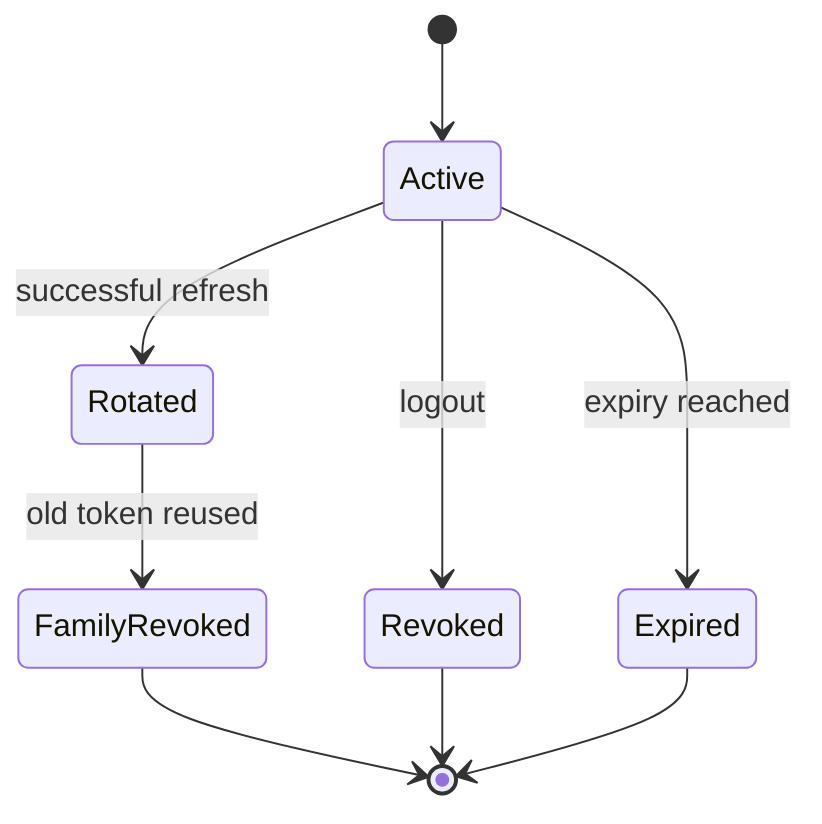

# Authentication and Sessions

## Access tokens

The API issues short-lived JWT access tokens after a successful login. Clients send the access token using the standard bearer authorization header:

```http
Authorization: Bearer <access-token>
```

The JWT lifetime is configured by `Jwt:ExpirationMinutes`.

## Refresh tokens

A successful login also creates a refresh-token session. Refresh tokens are generated from 64 cryptographically secure random bytes. The raw value is returned only as an `HttpOnly` cookie; PostgreSQL stores its SHA-256 hash, never the raw token.

The refresh-token lifetime is configured by `RefreshTokens:ExpirationDays` (default: 30 days; allowed range: 1–90 days).

Cookie settings:

- Name: `ecommerce.refresh-token`
- `HttpOnly`: enabled
- `SameSite`: `Strict`
- `Secure`: enabled outside Development, and enabled in Development when the request uses HTTPS
- Path: `/api/auth`

The cookie is intentionally not included in the JSON response. Browser clients must send credentials on cross-origin requests and the API must list the frontend origin in `Cors:AllowedOrigins`. The current `SameSite=Strict` policy expects the frontend and API to be same-site; a genuinely cross-site deployment needs an explicit cookie/CORS/CSRF design review before changing this policy.

## Session rotation and replay detection

Every successful login creates a new token family, allowing a user to have independent sessions on multiple devices. A refresh operation:

1. Hashes the presented cookie value and looks up the matching database record.
2. Rejects unknown or expired tokens.
3. Rejects a revoked token and revokes every still-active token in that token's family. This is the replay-detection response.
4. For an active token, atomically revokes it and creates its replacement in the same family.
5. Uses `RevokedAtUtc` as an optimistic concurrency token so two concurrent requests cannot both rotate the same token successfully. A concurrency loser revokes the family.

Logout revokes the entire token family associated with the supplied refresh token and clears the browser cookie. This also invalidates a replacement token if logout races with rotation or arrives using a recently rotated cookie; other independent device sessions (different families) remain active.



## CSRF protection for refresh-token cookies

The `POST /api/auth/login`, `POST /api/auth/refresh`, and `POST /api/auth/logout` endpoints validate the request source using the `Origin` header, falling back to `Referer` only when `Origin` is absent. Login is included because it creates the refresh-token cookie; refresh and logout consume or revoke that cookie. The source must match either the API request origin or an exact origin listed in `Cors:AllowedOrigins`. Missing, `null`, malformed, and untrusted source origins are rejected with `403 Forbidden`.

Browser clients should send requests from an allowed frontend origin. Non-browser clients and `.http` requests must send an explicit `Origin` header. `SameSite=Strict` remains an additional defense; CORS alone is not treated as CSRF protection.

## Endpoints

| Method | Endpoint | Purpose |
|---|---|---|
| POST | `/api/auth/register` | Create a customer account |
| POST | `/api/auth/login` | Authenticate, return an access token, and set the refresh cookie |
| GET | `/api/users/me` | Return the authenticated user's profile |
| PUT | `/api/users/me` | Update the authenticated user's first and last name |
| PUT | `/api/users/me/password` | Change the authenticated user's password and revoke all refresh-token sessions |
| POST | `/api/auth/refresh` | Rotate the refresh cookie and return a new access token |
| POST | `/api/auth/logout` | Revoke the current refresh token and clear the cookie |

All authentication endpoints use the existing `auth` rate-limit policy.

## Local verification

1. Run the API over HTTPS in Development.
2. Call `POST /api/auth/login` using a seeded user. Save the access token from the JSON response.
3. Call an authenticated endpoint with `Authorization: Bearer <access-token>`.
4. Call `POST /api/auth/refresh`; the HTTP client must retain and send the `ecommerce.refresh-token` cookie from login.
5. Verify the response contains a new access token and that the refresh cookie has been replaced.
6. Call `POST /api/auth/logout` and then try refreshing again; the refresh attempt must return `401 Unauthorized`.
7. For replay detection, capture a refresh cookie value before rotation, rotate it once, then submit the old value again. The replay must fail and invalidate the replacement token from the same family.
8. Call `GET /api/users/me` with the access token and verify that the response contains the current user's id, email, first name, last name, and seller status.
9. Call `PUT /api/users/me` with new `firstName` and `lastName` values, then call GET again and verify the names were updated. The email and seller status are not editable through this endpoint; email changes require a separate verification flow.
10. Call `PUT /api/users/me/password` with the current password and a new password that satisfies the configured Identity password policy. The request returns `204 No Content`; an incorrect current password or a new password that fails the Identity policy returns `400 Bad Request`.
11. After a successful password change, all active refresh-token sessions for that user are revoked in the same database transaction. Other devices must authenticate again. Existing access JWTs remain valid until their configured expiration because access-token revocation is not currently implemented.

## Database migration

After adding the refresh-token entity and EF Core configuration, generate the migration from the solution directory:

```powershell
dotnet ef migrations add AddRefreshTokens --project ECommerce.Infrastructure --startup-project ECommerce.API
```

Production deployments must apply this migration through the existing deployment migration process. Development startup and the PostgreSQL Testcontainers fixture apply migrations automatically.
