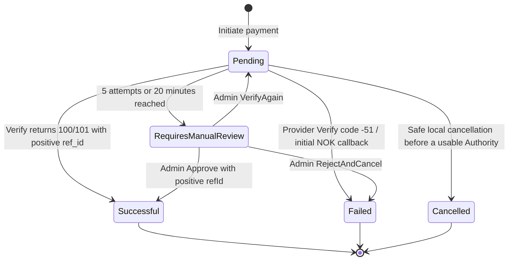
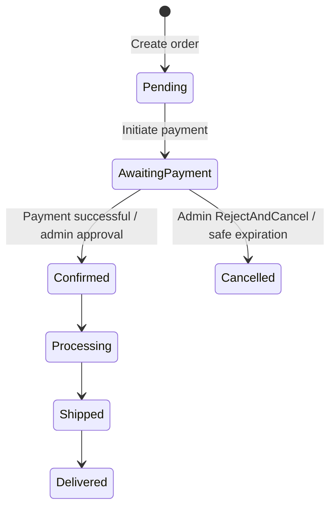

# Payment and order state machine

This document describes the ZarinPal payment lifecycle, including the operational path for payments that reach `RequiresManualReview`. All application amounts are stored in Toman.

## Payment transitions

`VerifyAgain` does not reset `VerificationAttemptCount`, `FirstVerificationAttemptedAt`, `LastVerificationAttemptedAt`, or the last provider error. It opens one operator-authorized Verify attempt after the same persisted two-minute lease has elapsed. A definitive provider success moves to `Successful`; code `-51` moves to `Failed`; an indeterminate response moves back to `RequiresManualReview` because the configured automatic retry limit has already been reached. A gateway configuration failure also leaves the payment in `RequiresManualReview`.

A positive `refId` is mandatory for `Approve`. The administrator must first verify the payment independently against ZarinPal's merchant dashboard or settlement evidence. `Approve` stores the reference, marks the payment successful, and confirms the order. It is not a refund operation.

`RejectAndCancel` is permitted only from `RequiresManualReview`. It marks the payment failed before invoking the existing order cancellation domain rules. The order, payment, seller-offer stock restoration, and audit record are committed in one database transaction; any persistence failure rolls back all of them. This action must only be used after confirming that the provider did not collect funds.

## Order transitions

The order remains `AwaitingPayment` while a payment is `RequiresManualReview`. Reserved inventory stays deducted from seller-offer stock; the expiration worker excludes the order. A normal failed payment can permit a new payment attempt, but a payment in manual review blocks new attempts until an administrator resolves it.

## Operational endpoint

`POST /api/admin/payments/{paymentId}/resolve` requires the `Admin` role. The payment ID and current state are available from `GET /api/admin/orders/{orderId}`. The required request fields are `action` and `reason`; `refId` is additionally required for action `2` (`Approve`). Action values: `1` = `VerifyAgain`, `2` = `Approve`, `3` = `RejectAndCancel`.

`GET /api/admin/orders?hasManualReview=true` lists orders containing a manual-review payment; `hasManualReview=false` excludes them. The order details response exposes payment IDs and the attempt/error/review metadata needed by an administrator.

## Audit trail

`PaymentResolutionAudits` is append-oriented operational history. It records `AdminUserId`, `PaymentId`, `OrderId`, action, required reason, provider `RefId` when available, provider error code when returned, UTC creation and completion timestamps, outcome, post-operation statuses, and (for rejection) restored item/quantity totals. Verify operations first persist an incomplete audit record before calling the provider. A record without `CompletedAtUtc` indicates an interrupted resolution request and must be investigated rather than assumed successful. Audit rows reference the administrator, order, and payment with restrictive foreign keys and are not removed by the resolution workflow.
